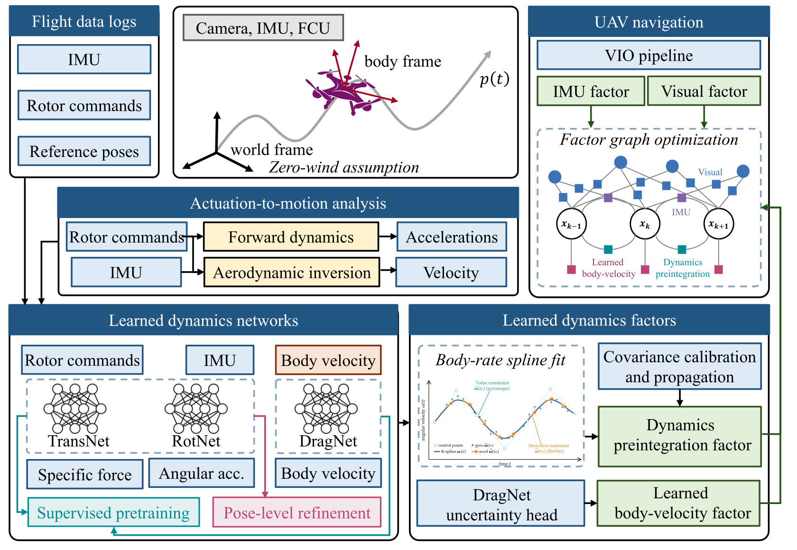
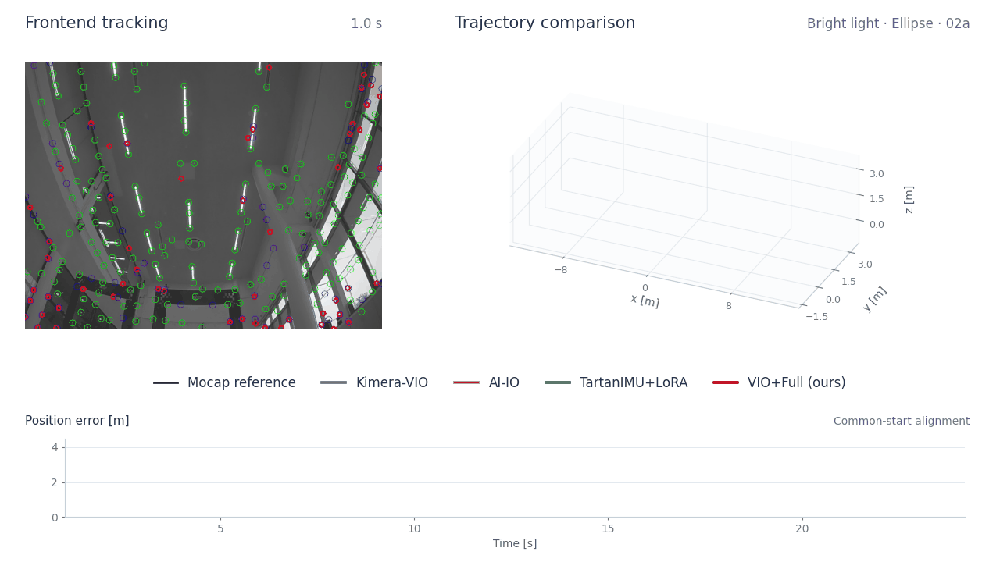
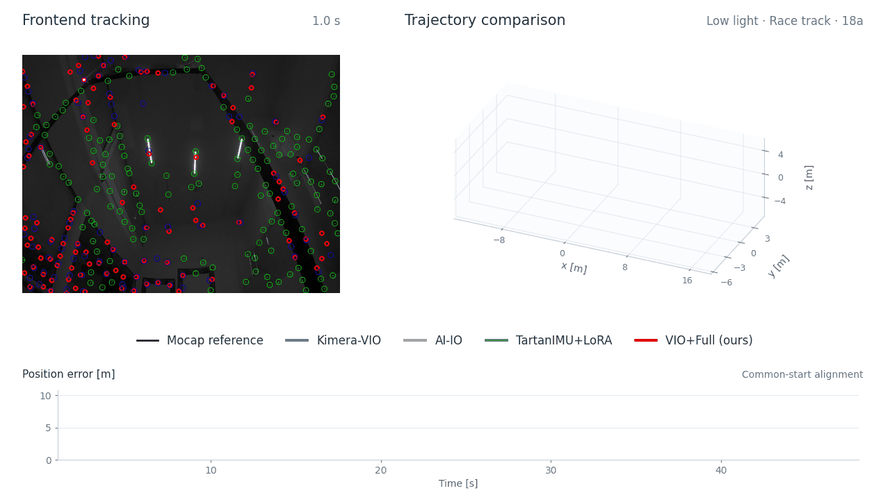
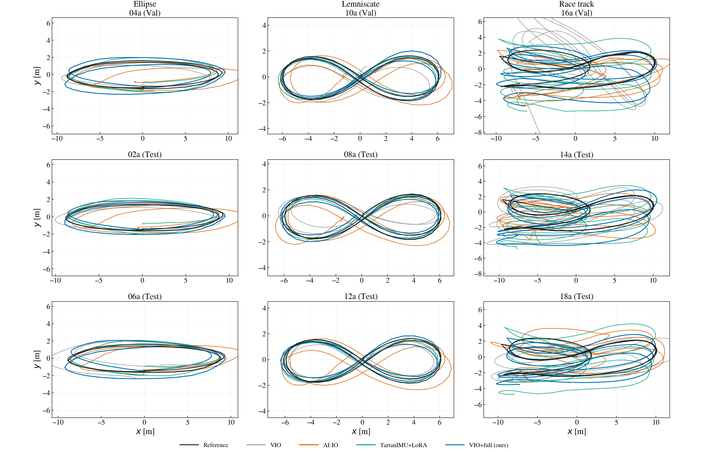

<h1 align="center">A2M-VIO</h1>

<strong>Learning Actuation-to-Motion Dynamics for Quadrotor Visual–Inertial Estimation</strong>

  <a href="#method">Method</a> ·
  <a href="#demo">Demo</a> ·
  <a href="#experimental-results">Results</a> ·
  <a href="#dataset">Dataset</a> ·
  <a href="#code-availability">Code availability</a>

> **Publication status:** The manuscript is currently in the submission process.
> This repository presents the method, demonstrations, and experimental results.
> **Source code will be released after the paper is published.**

A2M-VIO learns the relationship between quadrotor actuation and motion, then
incorporates learned dynamics and body-velocity observations into visual–inertial
estimation. Three temporal convolutional networks—**TransNet**, **RotNet**, and
**DragNet**—support two learned factors in a Kimera-VIO estimator.

## Method

| Component | Role |
|:---|:---|
| **TransNet** | Predicts body-frame specific force from actuation history and motion state. Pose-level refinement uses a position weak-form loss. |
| **RotNet** | Predicts angular acceleration. Pose-level refinement uses cumulative attitude checkpoints; gyro measurements and RotNet predictions jointly fit an angular-velocity spline. |
| **DragNet** | Predicts body-frame velocity from IMU and actuation histories, with a separately trained MLP uncertainty head on frozen mean features. |
| **Dynamics preintegration factor** | Integrates predicted specific force and spline-derived rotation into relative velocity and position constraints. |
| **Learned body-velocity factor** | Constrains the estimator's body-frame velocity using DragNet predictions and uncertainty. |

The two factors complement visual and IMU measurements. Sensor histories are
causal during estimation; motion-capture ground truth is used for offline
supervision and evaluation, not as an online estimator input.

[Method and baseline descriptions](docs/METHODS.md)

## Demo

Two Test flights illustrate different trajectory families and lighting conditions.
They were selected after inspecting results to highlight favorable outcomes;
[all per-flight localization scores](results/localization_per_flight.csv) are retained.

**Bright natural light · Ellipse · 02a**

  

**Low artificial light · Race track · 18a**

  

<a href="assets/homepage_demo_02a.mp4">02a video</a> · <a href="assets/homepage_demo_18a.mp4">18a video</a> · <a href="docs/DEMO.md">Visualization details</a>

The videos combine native frontend feature tracking, synchronized 3D trajectories,
and position-error curves. They are post-run visualizations, not simultaneous
live execution of all methods. Trajectories share a displayed starting position;
quantitative ATE uses a separate full-trajectory SE(3) alignment.

## Experimental results

The experiments cover recursive motion prediction, body-velocity estimation and
uncertainty, gyro–RotNet spline fitting, and localization with factor ablations.

| Method | Validation mean ATE RMSE [m] | Test mean ATE RMSE [m] | Test completion |
|:---|---:|---:|:---:|
| Kimera-VIO | 3.5825 | 2.2425 | 6/6 |
| AI-IO | 1.6429 | 1.5338 | 6/6 |
| TartanIMU+LoRA | 1.4548 | 1.3523 | 6/6 |
| VIO+Dyn. | 1.7476 | — | 4/6 |
| VIO+Vel. | 1.2372 | 1.0591 | 6/6 |
| **VIO+Full (ours)** | **1.0607** | **0.9865** | **6/6** |

ATE is translation RMSE from official evo `-a`, with SE(3) alignment and no scale
correction. Flights are equally weighted. AI-IO and TartanIMU+LoRA are standalone
odometry baselines; VIO+Dyn./Vel./Full are factor ablations of the same VIO system.
Dynamics-only fails on Test flights 12a/14a, so no successful-subset Test mean is
reported. The full method completes all nine evaluation flights, but does not
outperform every baseline on every flight.

[All four experiments and evaluation protocols](docs/RESULTS.md) ·
[Per-flight localization](results/localization_per_flight.csv) ·
[Aggregate localization](results/localization_summary.csv)

## Dataset

We use the **Race Against the Machine** drone-racing dataset released by
**TII Racing**, with 18 autonomous recordings across three trajectory families.

| Split | Ellipse | Lemniscate | Race track |
|:---|:---|:---|:---|
| Train | 01a, 03a, 05a | 07a, 09a, 11a | 13a, 15a, 17a |
| Validation | 04a | 10a | 16a |
| Test | 02a, 06a | 08a, 12a | 14a, 18a |

The same ordinal split is used within each trajectory family. Network adaptation
uses Train data with Validation selection; Test does not select model parameters
or fusion scales for the reported configuration. The dataset itself is not
redistributed here.

[Official dataset](https://github.com/tii-racing/drone-racing-dataset) ·
[Data downloads](https://github.com/tii-racing/drone-racing-dataset/releases) ·
[Dataset paper](https://arxiv.org/abs/2311.02667)

## Code availability

This is a **project showcase**, not an executable software release. Source code,
training scripts, model checkpoints, calibration tools, and deployment code are
not included at this stage. Source code will be released after the paper is
published; release announcements and paper information will be added here.

The result tables and media describe the reported experiments. They are not a
standalone reproducibility package, and this repository currently provides no
installation or launch instructions.

## Related methods and acknowledgements

We acknowledge the authors of [Kimera-VIO](https://github.com/MIT-SPARK/Kimera-VIO),
[GTSAM](https://github.com/borglab/gtsam),
[AI-IO](https://github.com/SJTU-ViSYS-team/AI-IO),
[TartanIMU](https://github.com/superxslam/TartanIMU),
and the [TII Racing dataset](https://github.com/tii-racing/drone-racing-dataset).
See [method descriptions](docs/METHODS.md) for their roles in this study.
These projects retain their own licenses and attribution requirements.
