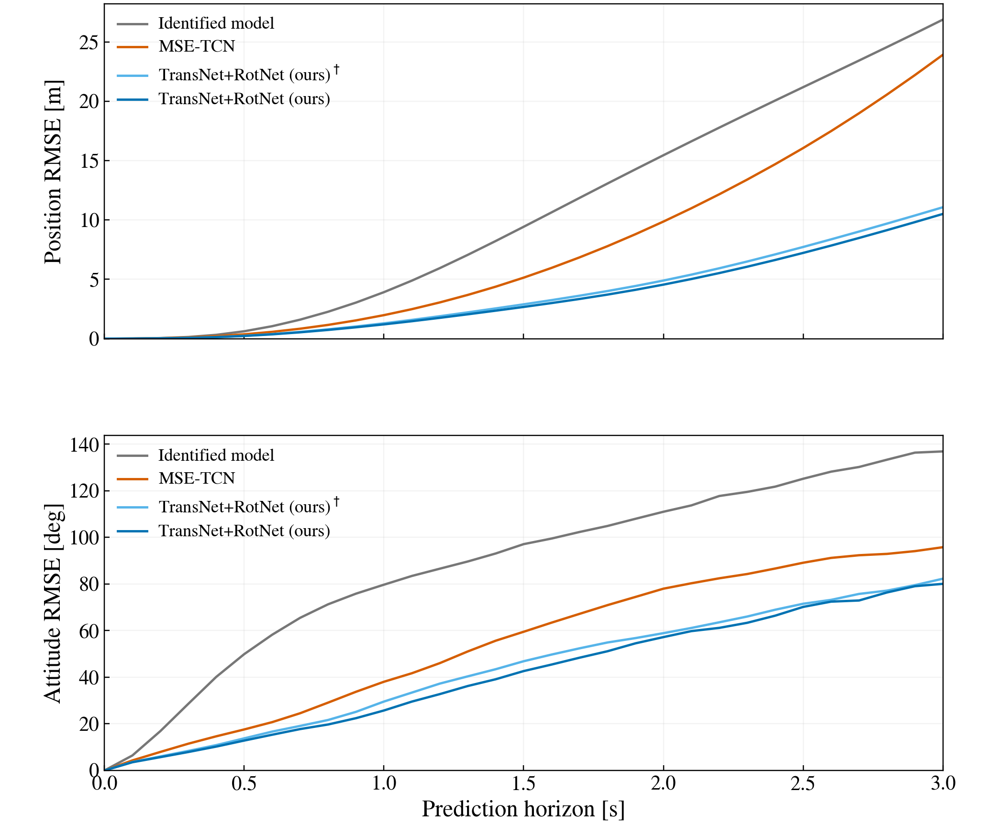
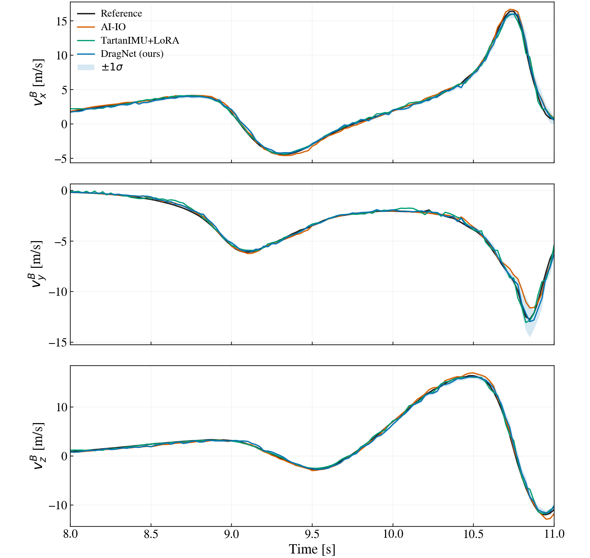
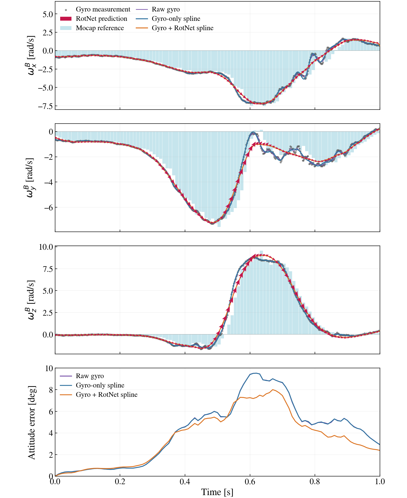
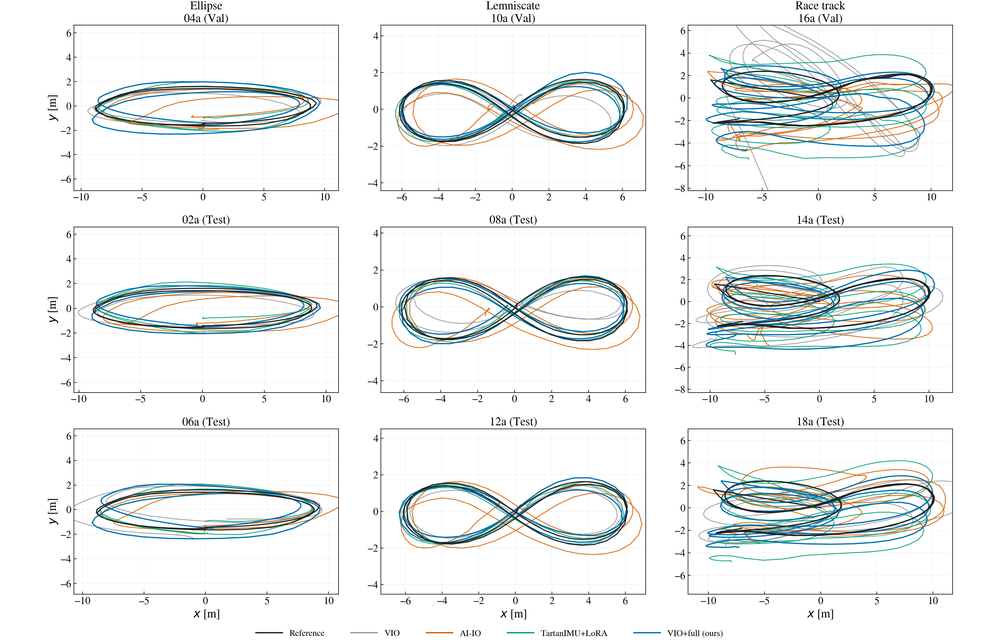

# Experimental results

These tables and figures summarize the frozen manuscript experiments. They are
shared during submission; implementation and model artifacts remain private
until publication. No new training, parameter search, or evaluation was performed
to prepare this showcase.

## 1. Coupled motion rollout

The identified model, full-state MSE-TCN, and TransNet–RotNet pair share initial
motion-capture position/attitude and initial velocities estimated from preceding
100 ms observations. They then jointly propagate position, velocity, attitude,
and angular velocity without future reference-state resets. The full-state
baseline additionally receives its required pre-start history.

The offline forecast uses recorded actuation as exogenous input, a 10 ms midpoint
step, starts approximately 0.1 s apart, and common 3 s support. Position-vector
and SO(3) geodesic endpoint errors are converted to RMSE within each flight,
then equally averaged over six Test flights. Overlapping windows are not
independent samples. This is distinct from reference-conditioned qualitative
acceleration plots and online localization.

[Rollout RMSE table](../results/rollout.csv)

## 2. Body-frame velocity and uncertainty

Instantaneous body-frame velocity is evaluated against a common fitted
motion-capture reference at shared airborne queries, nominally 25 ms apart.
Each query uses the latest already available prediction, without interpolation
toward a future network output. Vector RMSE is computed per flight; each family
averages two Test flights and Overall equally averages all six.

| Method | Ellipse [m/s] | Lemniscate [m/s] | Race track [m/s] | Overall [m/s] |
|:---|---:|---:|---:|---:|
| AI-IO | 0.5074 | 0.2958 | 0.6294 | 0.4775 |
| TartanIMU+LoRA | 0.3943 | 0.2633 | 0.6664 | 0.4414 |
| **DragNet (ours)** | **0.3880** | **0.2537** | **0.5374** | **0.3931** |

The fixed-feature MLP uncertainty head is evaluated at native eligible command
nodes using marginal one- and two-standard-deviation coverage. Coverage is
averaged equally across flights within each split; Gaussian nominal coverage is
68.27% and 95.45%. These diagnostics do not establish temporal independence or
exact Gaussian calibration, and coverage varies across axes and splits.

[Velocity RMSE](../results/body_velocity_rmse.csv) ·
[Train/Validation/Test uncertainty coverage](../results/body_velocity_coverage.csv)

## 3. Gyro–RotNet spline fitting

Compare raw gyro, gyro-only splines, and gyro+RotNet splines under reference
inputs and a noisy-input condition. The published 1 s table retains all 18
flights. Splines use 20 ms knots and 10 ms midpoint integration; the raw-gyro
control uses trapezoidal integration over the original measurements. RotNet
model variances are fixed at the selected values near 0.4708 rad²/s⁴ per axis.

Reference-input states use fits to preceding raw-mocap observations. The noisy
condition uses measured gyro and constant body-velocity perturbations with
standard deviation 0.3 m/s, evaluated over four draws. This is an independent
spline experiment, not a claim that online localization receives reference
states. Error is relative-attitude SO(3) geodesic RMSE per flight, in degrees.

[All-flight 1 s spline results](../results/spline_1s_all_flights.csv)

## 4. Localization and factor ablations

Scores use official evo `-a`: translation ATE RMSE after SE(3) alignment, without
scale correction, at the common evaluation timestamps. Means equally weight
flights rather than pooling all trajectory samples.

AI-IO and TartanIMU+LoRA run as standalone odometry. VIO+Dyn., VIO+Vel., and
VIO+Full retain the same visual/IMU backbone and frozen selected covariance
multipliers. Selection uses Train+Validation; Test is evaluated afterward.
The reported covariance multipliers are approximately 42.170 for dynamics and
3.162 for velocity. They multiply covariance, not residuals or standard deviation.

| Method | Validation mean [m] | Test mean [m] | Validation completion | Test completion |
|:---|---:|---:|:---:|:---:|
| Kimera-VIO | 3.5825 | 2.2425 | 3/3 | 6/6 |
| AI-IO | 1.6429 | 1.5338 | 3/3 | 6/6 |
| TartanIMU+LoRA | 1.4548 | 1.3523 | 3/3 | 6/6 |
| VIO+Dyn. | 1.7476 | — | 3/3 | 4/6 |
| VIO+Vel. | 1.2372 | 1.0591 | 3/3 | 6/6 |
| VIO+Full (ours) | 1.0607 | 0.9865 | 3/3 | 6/6 |

Dynamics-only fails on Test 12a/14a. Those failures are retained; neither truncated
trajectory scores nor successful-subset means stand in for a complete Test mean.
Full completes all nine evaluation flights, but individual baseline wins remain
visible. These are frozen paper-protocol results; they must not be mixed with
later raw-command-adapter checks or earlier parameter configurations.

[Per-flight table](../results/localization_per_flight.csv) ·
[Aggregate table](../results/localization_summary.csv)

## Scope

Results support the reported configuration and dataset. They do not establish
universal improvement, exact physical-noise calibration, bitwise cross-hardware
training reproducibility, or hard-real-time execution. The demonstrations are
post-run visualizations. The dataset has been used in previous studies within
this project; the selection split is disclosed without claiming a previously
unexamined dataset.
